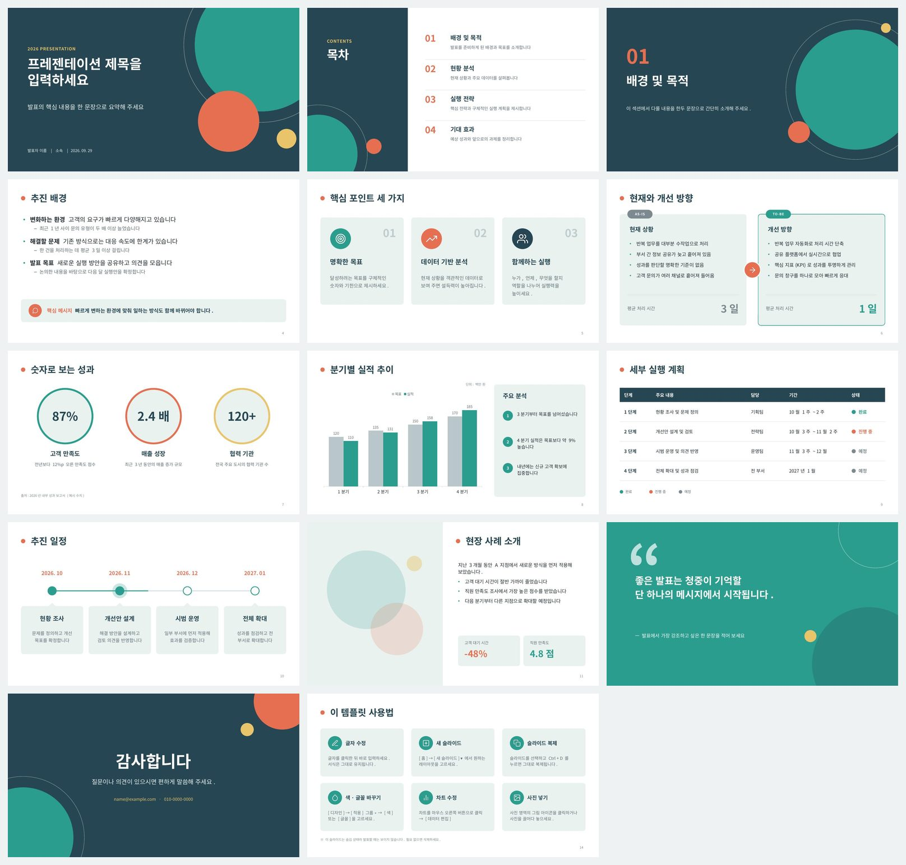

# 편집 가능한 PPT 템플릿

PowerPoint에서 바로 열어 글자, 색, 사진, 차트를 자유롭게 고칠 수 있는 한국어 발표 템플릿입니다.

- 파일: [`ppt-template.pptx`](ppt-template.pptx) (16:9 와이드, 14장)
- 다운로드: 파일을 클릭한 뒤 오른쪽 위의 **Download raw file** 버튼을 누르세요.



## 들어 있는 슬라이드

| 번호 | 슬라이드 | 사용한 레이아웃 |
| --- | --- | --- |
| 1 | 표지 | 표지 |
| 2 | 목차 | 목차 |
| 3 | 섹션 구분 | 섹션 구분 |
| 4 | 제목 + 글머리 기호 | 제목 및 내용 |
| 5 | 핵심 포인트 카드 3개 | 제목만 |
| 6 | 현재/개선 비교 (AS-IS / TO-BE) | 비교 (2단) |
| 7 | 핵심 수치 | 제목만 |
| 8 | 막대 차트 + 분석 | 제목만 |
| 9 | 실행 계획 표 | 제목만 |
| 10 | 추진 일정 (타임라인) | 제목만 |
| 11 | 사진 + 내용 | 사진 + 내용 |
| 12 | 핵심 메시지 | 핵심 메시지 |
| 13 | 마무리 (감사합니다) | 마무리 |
| 14 | 템플릿 사용법 (숨김 슬라이드, 발표 때는 안 보임) | 제목만 |

## 사용법

- **글자 수정**: 글자를 클릭하고 바로 입력하면 서식이 그대로 유지됩니다.
- **새 슬라이드**: [홈] → [새 슬라이드] ▾ 에서 레이아웃 10종(표지, 목차, 섹션 구분, 제목 및 내용, 제목만, 비교 (2단), 사진 + 내용, 핵심 메시지, 마무리, 빈 화면) 중 하나를 고르세요.
- **슬라이드 복제**: 마음에 드는 슬라이드를 선택하고 `Ctrl + D`.
- **색 한 번에 바꾸기**: [디자인] → [적용] 그룹 ▾ → [색] 에서 다른 색 조합을 고르면 배경, 도형, 차트, 표 색이 모두 함께 바뀝니다.
- **글꼴 한 번에 바꾸기**: [디자인] → [적용] 그룹 ▾ → [글꼴].
- **차트 수정**: 차트를 마우스 오른쪽 버튼으로 클릭 → [데이터 편집].
- **사진 넣기**: 사진 영역 가운데의 그림 아이콘을 클릭하거나 사진을 끌어다 놓으세요.
- **배경 디자인 수정**: [보기] → [슬라이드 마스터]에서 레이아웃의 원 도형, 글자 위치 등을 바꿀 수 있습니다.
- 카드, 목차 항목 같은 요소는 그룹으로 묶여 있습니다. 한 번 클릭하면 그룹 전체, 한 번 더 클릭하면 안쪽 요소를 따로 고칠 수 있습니다.
- 글꼴은 Windows 기본 글꼴인 **맑은 고딕**을 사용합니다. Mac에 맑은 고딕이 없으면 비슷한 한글 글꼴로 자동 대체됩니다.

## 템플릿 다시 만들기 (개발자용)

`generator/` 폴더의 스크립트로 같은 파일을 다시 생성할 수 있습니다.
Node.js와 Python 3(`lxml`)이 필요합니다.

```bash
cd generator
npm install
pip install lxml
./build.sh   # ../ppt-template.pptx 를 새로 만듭니다
```

- `build.js`: [PptxGenJS](https://gitbrent.github.io/PptxGenJS/)로 레이아웃 배경, 도형, 차트, 표, 아이콘을 만듭니다.
- `postprocess.py`: 테마 색과 글꼴, 슬라이드 마스터 스타일, 개체 틀(제목, 텍스트, 그림, 슬라이드 번호), 그룹을 정리해 편집하기 좋은 템플릿으로 만듭니다.
