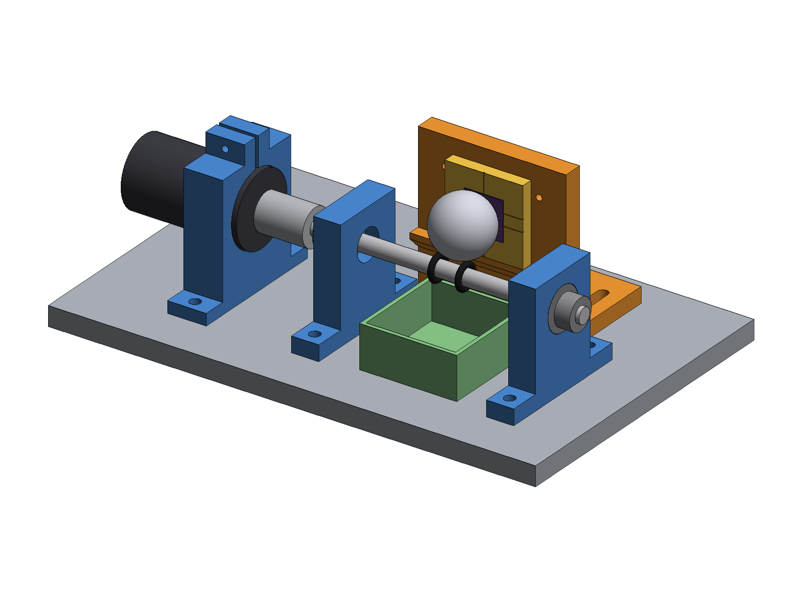

# 볼 크레이터 두께 측정기 도면

금속 다층막(예: 3층)의 층별 두께를 재기 위한 볼 크레이터(Calotest) 장치의 제작 도면입니다.
회전하는 쇠구슬이 시료에 얕은 구덩이를 갈아 내면, 현미경으로 층별 고리 지름을 재서 두께를 계산합니다.



## 파일

| 경로 | 내용 |
| --- | --- |
| [`drawings/ball-crater-tester_drawings.pdf`](drawings/ball-crater-tester_drawings.pdf) | 도면 6장 (A3, 3각법). 인쇄용 |
| `drawings/sheet-*.png` | 같은 도면의 장별 이미지 |
| `stl/*.stl` | 3D 프린트 부품. 출력 방향으로 이미 눕혀 둠 |
| [`dxf/P01_base_plate.dxf`](dxf/P01_base_plate.dxf) | 베이스판 레이저 가공용 (외곽 + 구멍 8개) |
| `design/` | 도면, STL, DXF 를 만드는 파이썬 코드. 치수는 `design/params.py` 한 곳에 있음 |

### 도면 목록

| 장 | 도면번호 | 내용 |
| --- | --- | --- |
| 1 | BCT-00 | 조립도 (정면·평면·우측면 1:2, 등각도), 부품표 19항목, 주기 |
| 2 | BCT-01 | 단면 A-A (1:1), 공 접촉부 상세 (2:1), 하중 설정표, 사용 순서 |
| 3 | BCT-02 | P01 베이스판 (구멍 위치표), P08 구동축 |
| 4 | BCT-03 | P02 베어링 블록, P03 모터 클램프 |
| 5 | BCT-04 | P04 시료 홀더 |
| 6 | BCT-05 | P05 시료 캐리어 (2:1), P06 연마제 받침, P07 간격 게이지 |

## 구조 요약

- 모터 → 커플링 → Ø8 축 (608 베어링 2개) → 축 위의 O링 2개에 Ø30 쇠구슬이 얹힙니다.
- 공은 세워진 시료면에 기대고, 축이 돌면 공도 같이 돌면서 시료를 갈아 냅니다.
- 시료 홀더는 장공으로 앞뒤 11 mm 움직여, 축 중심~시료면 거리 D 를 17~28 mm 로 바꿉니다.
  D 가 커질수록 공이 시료를 누르는 힘이 커집니다 (약 0.1~0.9 N, 도면 BCT-01 표).
- 시료는 캐리어(40×40)에 붙여 핀 두 개로 홀더에 끼웁니다. 빼서 현미경으로 본 뒤 같은 자리로 되돌릴 수 있고,
  8 mm 간격으로 다섯 곳에 크레이터를 낼 수 있습니다.

## 3D 프린트

| 부품 | 파일 | 수량 | 채움 | 메모 |
| --- | --- | --- | --- | --- |
| P02 베어링 블록 | `P02_bearing_block_x2.stl` | 2 | 100 % | 베어링 자리 Ø22.2 가 위로 오게 출력됨 |
| P03 모터 클램프 | `P03_motor_clamp.stl` | 1 | 100 % | 모터 기어박스 지름을 재고 구멍을 맞출 것 |
| P04 시료 홀더 | `P04_sample_holder.stl` | 1 | 40 % 이상 | 서포트 없이 출력 가능 |
| P05 시료 캐리어 | `P05_sample_carrier.stl` | 3 | 40 % 이상 | 시료 붙이는 면이 바닥 |
| P06 연마제 받침 | `P06_drip_tray.stl` | 1 | 20 % 이상 | |
| P07 간격 게이지 | `P07_gap_gauge.stl` | 1 | 100 % | 출력 후 캘리퍼스로 단 확인 |

PETG, 층 높이 0.2 mm 기준입니다. 압입·끼워맞춤 치수(Ø22.2, Ø37.4, Ø3.2)는 프린터마다 다르므로 먼저 시험 출력해 보세요.

## 꼭 확인할 것

- **구입품 치수**: 모터(JGB37-520 계열), 커플링, 축 칼라 치수는 일반적인 제품 기준 예시입니다. 실물을 받은 뒤 재 보고,
  다르면 `design/params.py` 의 값을 고쳐 다시 만드세요.
- **회전 방향**: 축 윗면이 시료 반대쪽(앞)으로 움직이게 돌려야 합니다. 반대로 돌리면 공이 축과 시료 사이로
  끌려 들어가 하중이 불안정해집니다 (도면 BCT-01).
- **하중 값**: 표의 하중은 공 무게와 기하학으로 계산한 값입니다. 실제 값은 연마제 마찰에 따라 10~30 % 작습니다.
  같은 실험에서 같은 게이지 단을 쓰면 비교에는 문제가 없습니다.
- 3D 모델로 조립 간섭 검사를 했고 겹치는 부품은 없습니다 (공~축 틈새 1.3 mm).

## 다시 만들기

```bash
cd ball-crater-tester/design
pip install -r requirements.txt
./build.sh        # stl/, dxf/, images/, drawings/ 를 새로 만듭니다 (약 1분)
```

- `params.py`: 모든 치수
- `models.py`: 3D 모델, STL·DXF 내보내기, 간섭 검사
- `drafting.py`: 도면 틀, 투상도 렌더, 치수선
- `drawings.py`: 도면 6장 구성
